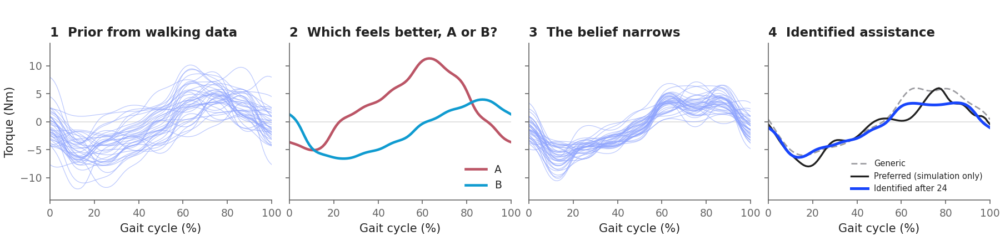
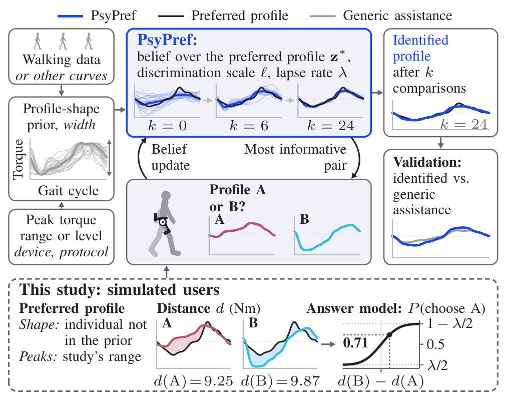
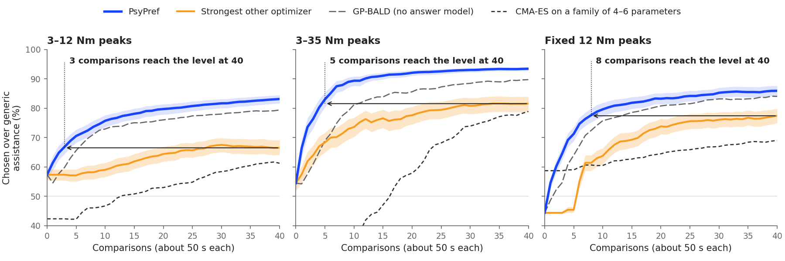

# PsyPref

**Optimize an exoskeleton's assistance curve from few pairwise comparisons.**

Assistance that fits the person often works best, and users can say which of two torque profiles feels better. PsyPref decides
which two profiles to compare next and what to make of each answer, using Bayesian adaptive methods from psychophysics: prior
knowledge, the most informative comparison, and a model of noisy answers. After 3–8 comparisons, simulated users choose its
profile over generic assistance as often as the profile that the best published optimizer reaches after 40 comparisons.

<picture>
  <source media="(prefers-color-scheme: dark)" srcset="assets/session_dark.gif">
  
</picture>

> **Everything here is simulated, with simulated users.** No person has used PsyPref yet. It rests on assumptions that only experiments with real users can test, above all that individuals judge entire profiles and have a single preferred profile. See [what the results depend on](#what-the-results-depend-on).

## Quick start

```bash
git clone https://github.com/TUDA-MUST/exo-psypref.git
cd exo-psypref
pip install -e .
python examples/quickstart.py
```

```python
from psypref import Prior, PsyPref

prior = Prior.from_walking(peak_range=(3, 12))   # hip torque peaks your device and protocol allow, in Nm
session = PsyPref(prior)

for k in range(24):
    a, b = session.ask()                  # two torque curves, 101 points over the gait cycle
    session.tell(show_to_user(a, b))      # your code: "A", "B", or None for no preference

curve = session.identified()              # the identified assistance
```

Show each profile long enough to feel it. With 20 s per profile, as in Ramella et al.'s study, a comparison takes about 50 s, so 24
comparisons take about 20 min. Present each pair in random order, and keep your controller's own torque limits in place.

## How it works

<picture>
  <source media="(prefers-color-scheme: dark)" srcset="assets/how_it_works_dark.png">
  
</picture>

PsyPref describes the profile with eight weights of a probabilistic movement primitive (ProMP), a sum of basis functions over the gait cycle, and keeps a belief about the
profile the user prefers. It begins with a prior built from other individuals' walking data, asks the pair expected to reveal most, and
treats each answer as a noisy choice. It learns how sharply the user discriminates during the session, so nobody has to measure a
just-noticeable difference (JND) first.

## Make it fit your study

| Your question | Where to look |
|---|---|
| Which prior? How wide? Which peak range? How many weights? | [Choosing a prior](docs/choosing_a_prior.md) |
| My study needs interpretable parameters, or my device only produces certain shapes | [Projection onto a family](docs/projections.md) |
| Another joint, device or population | [Using PsyPref on another exoskeleton](docs/other_exoskeletons.md) |

| You want | Call |
|---|---|
| Walking data, peaks free in a range | `Prior.from_walking(peak_range=(3, 12))` |
| Walking data, peaks fixed | `Prior.from_walking(level=12.0)` |
| Your own curves | `Prior.from_curves(curves, peak_range=(3, 12))` |
| One-sided assistance, or curves that count as they are | `Prior.from_curves(curves, limit=40.0)` |
| Some doubt about the prior | `prior.widened(2.0)` |
| Pairs shown in an interpretable family | `PsyPref(prior, family="schaefer")`, or your own `Family` |
| A session continued after a break | `PsyPref.replay(prior, session.answers, seed=seed)` |
| A dry run before anyone walks | `SimulatedUser(preferred, noise=1.0)`, see [examples](examples/) |

## What we found in simulation

<picture>
  <source media="(prefers-color-scheme: dark)" srcset="assets/concept_dark.png">
  
</picture>

The paper's Fig. 1: PsyPref's concept (solid boxes) and its evaluation with simulated users (dashed box). No person took part.
Each simulated user prefers the hip moment of one individual in a gait dataset who is not in the prior.

<picture>
  <source media="(prefers-color-scheme: dark)" srcset="assets/speed_dark.png">
  
</picture>

Means of 200 simulated users per setting, built from 5 individuals in a gait dataset, with 95 % intervals.

- **Fewer comparisons.** After 3–8 comparisons, simulated users choose PsyPref's profile over generic assistance as often as the
  profile that the best published optimizer reaches after 40 comparisons. All optimizers share the prior here, except CMA-ES on a family.
- **Prior and pairs carry the speed.** After 24 comparisons, a prior three times wider costs 15.4–21.4 points and random pairs 14.3–16.6,
  against 2.5–5.8 for replacing the answer model.
- **More weights do not slow it down,** but within one session they help little. They offer reach for longer sessions.
- **Not there yet.** After 24 comparisons, users stay 2.1–3.8 JND from their preferred profile, and they would still prefer profiles found later.

### What the results depend on

<picture>
  <source media="(prefers-color-scheme: dark)" srcset="assets/robustness_dark.png">
  
</picture>

In 68 of 75 robustness cases, simulated users choose PsyPref's profile more often than that of the best published optimizer.
The difference is not clearly above zero for users who judge single features or have no single preferred profile, and at fixed
12 Nm it is below zero on shapes from the comparator's own family and not clearly above zero for users who break six assumptions at
once. Where users discriminate more coarsely, the difference stays positive but the benefit over generic assistance shrinks: at fixed
12 Nm and a noise of 3 Nm, 28 % of the users would benefit by at least 1 JND. Our simulated users answer by a model close to
PsyPref's, and the prior fits them by construction, which favors PsyPref. How individuals judge assistance profiles has not been
measured; our next step is to test it with real users on a hip exoskeleton.

## Reproducing the paper

The code, the logs and every figure's data are here. [REPRODUCE.md](REPRODUCE.md) leads from each figure to its script and data,
and [CONDITIONS.md](CONDITIONS.md) lists every simulated condition with its size and source. The paper's supplement,
[supplement/supplement.pdf](supplement/supplement.pdf), gives PsyPref step by step, the simulated users, and every robustness
test against the best published optimizer (Fig. S1, which the paper's Fig. 4 summarizes).

```bash
pytest tests/test_psypref_library.py   # with the data bundle: this library reruns the paper's sessions, to within 1e-12 Nm
```

## How to cite

The paper, *Accelerating Hip Exoskeleton Preference Optimization: A Study with Simulated Users* (ICORR 2027), will be referenced here once it is published.

## License

The code is under the [MIT License](LICENSE). The data are under CC BY 4.0, subject to the terms of the source datasets.
